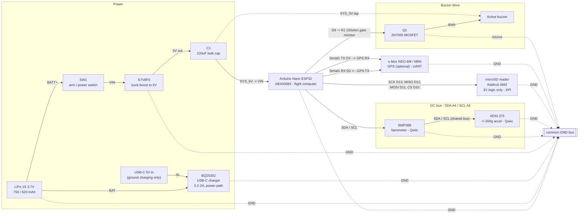
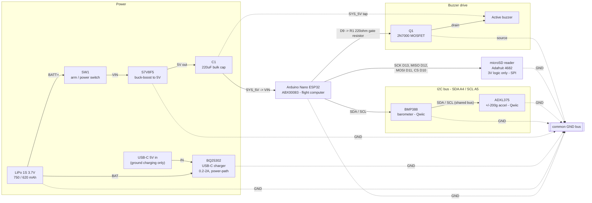

# Flight Computer — Interconnect Diagram

Companion to [`avionics_bom.md`](avionics_bom.md). Two variants: the full build (with GPS recovery locator) and a no-GPS variant (buzzer-only recovery). Pin assignments are the Arduino Nano ESP32's documented defaults (`SDA=A4`/`SCL=A5`, `SCK=D13`/`MISO=D12`/`MOSI=D11`/`CS=D10`, `Serial1` remapped to `D2`/`D3`).

Rendered/interactive versions (Claude Artifacts, private to this account):
- Full build: https://claude.ai/code/artifact/f4f62a39-6f6f-4bb3-88ec-8186684f46a7
- No-GPS variant: https://claude.ai/code/artifact/93769de8-e7bb-4562-b7f9-f643bc10d751

---

## Diagram — full build

### Pin reference — full build

| Net | Nano ESP32 pin | Connects to | Notes |
|---|---|---|---|
| SYS_5V | VIN | S7V8F5 VOUT, via C1 & SW1 | 1 V under the 6 V VIN spec — works per community testing, no margin |
| GND | GND | common ground bus | all board grounds tie to one bus |
| 3V3 | 3V3 | BMP388, ADXL375, SD reader, GPS | onboard buck output, shared rail |
| I²C | A4 (SDA) | BMP388 SDA, ADXL375 SDA | default Wire pins |
| I²C | A5 (SCL) | BMP388 SCL, ADXL375 SCL | default Wire pins |
| SPI | D13 (SCK) | SD reader SCK | default SPI pins |
| SPI | D12 (CIPO/MISO) | SD reader MISO | |
| SPI | D11 (COPI/MOSI) | SD reader MOSI | |
| SPI | D10 (CS) | SD reader CS | dedicated, not shared — no other SPI device on this bus |
| UART | D2 → Serial1 RX | GPS TX | remapped off D0/D1 — Serial0 carries boot/crash-dump text that would corrupt NMEA parsing |
| UART | D3 → Serial1 TX | GPS RX | wired for future config commands; most firmware never uses it |
| GPIO | D9 | R1 (220Ω) → Q1 gate | R2 (10kΩ) gate-to-GND pulldown holds buzzer off during boot |

---

## Diagram — no-GPS variant

Same harness, GPS module and its UART link omitted; recovery relies on the buzzer only. D2/D3 are left free (reserved in case GPS gets added back later).

### Pin reference — no-GPS variant

| Net | Nano ESP32 pin | Connects to | Notes |
|---|---|---|---|
| SYS_5V | VIN | S7V8F5 VOUT, via C1 & SW1 | 1 V under the 6 V VIN spec — works per community testing, no margin |
| GND | GND | common ground bus | all board grounds tie to one bus |
| 3V3 | 3V3 | BMP388, ADXL375, SD reader | onboard buck output, shared rail |
| I²C | A4 (SDA) | BMP388 SDA, ADXL375 SDA | default Wire pins |
| I²C | A5 (SCL) | BMP388 SCL, ADXL375 SCL | default Wire pins |
| SPI | D13 (SCK) | SD reader SCK | default SPI pins |
| SPI | D12 (CIPO/MISO) | SD reader MISO | |
| SPI | D11 (COPI/MOSI) | SD reader MOSI | |
| SPI | D10 (CS) | SD reader CS | dedicated, not shared — no other SPI device on this bus |
| GPIO | D9 | R1 (220Ω) → Q1 gate | R2 (10kΩ) gate-to-GND pulldown holds buzzer off during boot |

---

## Additions beyond the BOM

The BOM's open items and standard practice call for a few parts it doesn't list a part number for. None of these change the chain — they close gaps in it.

1. **SW1, arm/power switch** — placed between the battery/charger junction and the regulator's VIN, not directly on the battery terminal. That way the charger can still trickle-charge the battery with the switch off (pad-safe), and the whole downstream system is dead with the switch off — satisfying both open items in one part.
2. **C1, 220µF bulk cap** — across SYS_5V right at the regulator output, per the BOM's transient-current recommendation, to absorb SD-write/WiFi-TX current spikes without browning out the Nano.
3. **R1, 220Ω gate resistor** — not in the BOM, but a bare GPIO-to-gate connection is asking for ringing on a long lead to the buzzer. Cheap insurance.
4. **R2, 10kΩ pulldown** — ESP32 GPIOs can float momentarily during boot/reset; without this the buzzer could chirp on power-up before firmware sets D9 low.
5. **Serial1 on D2/D3 for the GPS** (full build only), instead of the default D0/D1 — Serial0 (D0/D1) is shared with the ESP32's boot log and crash dumps, which would land in the middle of NMEA sentences if the GPS shared that UART.
6. **SD reader and Qwiic parts on the 3V3 rail, not 5V** — the Nano ESP32's GPIOs are natively 3.3 V, so this is required regardless of the BOM's "no level shifter" caveat, not just a precaution.
7. **GPS module voltage** (full build only) — the BOM specifies a "GY-NEO6MV2-style" generic breakout, not a verified SKU. Most have an onboard 3.3 V regulator and accept 3.3–5 V in, with 3.3 V logic on TX/RX — confirm before wiring; if the specific module's UART is 5 V logic, its TX line needs a divider or level shifter into the Nano's RX1.
8. **SW2, wireless-arm interlock switch** — separate from SW1 (whole-board power cutoff, not firmware-readable). One leg to 3V3, other leg to `PIN_ARM_INTERLOCK` (D7) and to a new **R3, 10kΩ pulldown** to GND. Closed = interlock satisfied (the wireless ground-support AP powers up and `/arm` is permitted); open — or the signal wire broken — reads not-armed and the AP drops. Chosen over `INPUT_PULLUP` + switch-to-GND because the likely fault mode on this harness is the signal wire chafing against the common GND bus (the most abundant net on the board), which would read *armed* under that alternative topology; this topology reads *not armed* instead. Both topologies fail safe on a clean wire break — GND-chafe is the discriminator. See `../firmware/src/wireless.*` for how this gates the wireless ground interface; it can never reach the deployment channel (`PIN_DEPLOY`) — wireless FIRE does not exist.

---

## Wireless ground-support interface

New in this firmware revision: a WiFi access point + HTTP status/arm interface, intended for a ground-support device (e.g. a Raspberry Pi) to check on the rocket while it's on the pad — sensor readings, pad baseline, self-test/logger health, and a re-zero/"final arm" action — without touching the deployment channel. See `../firmware/src/wireless.*` for the implementation and the firmware's own plan notes for the full design rationale (SW2-gated radio power, confirmed-BOOST auto-kill, no wireless FIRE, `/config` as read-only display only).

**This reintroduces, in a now-routine form, the "SD write + WiFi burst" transient that the original `WiFi.mode(WIFI_OFF)` default was written to avoid** — the AP is up during every pad checkout while SW2 is closed, and a successful `/arm` does an SD-flush event-log write while the AP is still active. See the amended bulk-cap item in `avionics_bom.md`'s open items: **fit C1, or bench-verify the transient on a representative supply, before using this interface near a loaded rocket or an installed CO2 cartridge.**

---

Last updated: 2026-08-08
